# Mobile web responsiveness audit

**Scope:** the web app (`apps/web`) in a phone browser. Not the React Native app.
**Date:** 2026-11-24 · **Build:** branch `pvernin/relaxed-galileo-q9y3lo`, run locally with `pnpm dev` against the seeded dev catalog.

## Summary

Signed-out pages (landing, login, register, public news) mostly work on a phone. **Every signed-in page is broken**, for one main reason: the app navigation bar is 923px wide and never collapses. On a 390px phone the document becomes 923px wide (533px of sideways scroll). The browser then lays out every full-screen overlay against that 923px width, so the onboarding dialog shown right after sign-up, the "New list" dialog and the "Edit profile" dialog all open mostly off-screen. The account menu (sign out, profile) sits at x=887px and can't be reached without panning sideways.

Behind the nav there are smaller layout bugs that will still be there once the nav is fixed. The worst is the ranked list page, where titles shrink to `T…` and the reorder buttons sit on top of the metadata.

| #   | Severity | Issue                                                                    | Where                                    |
| --- | -------- | ------------------------------------------------------------------------ | ---------------------------------------- |
| 1   | Critical | App nav is 923px wide with no mobile layout, so every signed-in page scrolls sideways | all signed-in pages                      |
| 2   | Critical | Full-screen dialogs are centred in the 923px layout and open off-screen  | onboarding, New list, Edit profile       |
| 3   | Critical | Account menu (Profile / Sign out) is off-screen                          | all signed-in pages                      |
| 4   | High     | Ranked list rows collapse: titles become `T…` and buttons overlap text   | `/lists/:id`                             |
| 5   | High     | Page gutters are a fixed 40px on several routes                          | lists, list detail, profile              |
| 6   | High     | Kind filter shows unlabelled colour dots; labels only appear on hover    | Discover, History, News                  |
| 7   | Medium   | "Create & add" button extends past the edge of the Add to list dialog    | media page → Lists → + Add               |
| 8   | Medium   | Form fields use 15px text, so iOS Safari zooms in when a field is focused | every form                               |
| 9   | Medium   | Sticky landing nav wraps to 3 rows and takes 21% of the screen           | `/`                                      |
| 10  | Medium   | Many tap targets are below 44px (nav links 24px, kind chips 30px, timeline arrows 28px) | most pages                               |
| 11  | Low      | "ALL STATUSES" is clipped to "ALL STATUS"; "EVERYTHING" is truncated     | History, News filter bars                |
| 12  | Low      | Profile timeline is cramped: 11px labels and empty left third           | `/users/:username`                       |
| 13  | Low      | Trophy shelves cut items mid-word; copy says "click"                     | `/trophies`                              |

## Method

- Playwright with Chromium, phone emulation (`isMobile`, `hasTouch`), at **390×844** (iPhone 12–15) and **360×780** (small Android), DPR 2.
- Ran the real stack locally (web, api, catalog, worker, Postgres, Redis) with `pnpm db:seed`. The production URL couldn't be reached from the audit sandbox because its network policy blocks the host.
- Registered a fresh account, logged 13 titles across every status, and created a 5-item ranked list with a long title so the populated views have content.
- Captured 17 routes plus 15 overlay states (menus, dialogs, selects, popovers). For each one I measured `documentElement.scrollWidth` against `clientWidth`, listed the elements that cross the viewport edge, listed interactive elements smaller than 32px, and counted text nodes under 12px.
- Ran each overlay twice: **as shipped**, and with the nav overflow **neutralised** by injected CSS (`nav.sticky{max-width:100vw;overflow-x:auto}`). The second run separates problems caused by the nav from independent ones. Screenshots labelled "nav overflow removed" come from that second run and do not show shipped behaviour.

### Horizontal overflow by route (390px viewport)

| Route                                                                                  | `scrollWidth` | Sideways scroll |
| -------------------------------------------------------------------------------------- | ------------- | --------------- |
| `/`, `/login`, `/register`, `/news` (signed out)                                       | 390           | none            |
| `/home`, `/search`, `/news`, `/lists`, `/lists/:id`, `/users/:u`, `/users/:u/history`, `/trophies`, `/media/:slug` | **923**       | **533px**       |

At 360px the same pages are 923px wide (563px of sideways scroll). The width is the same everywhere because it comes from a single element: the nav.

---

## 1. Critical: the app nav never collapses

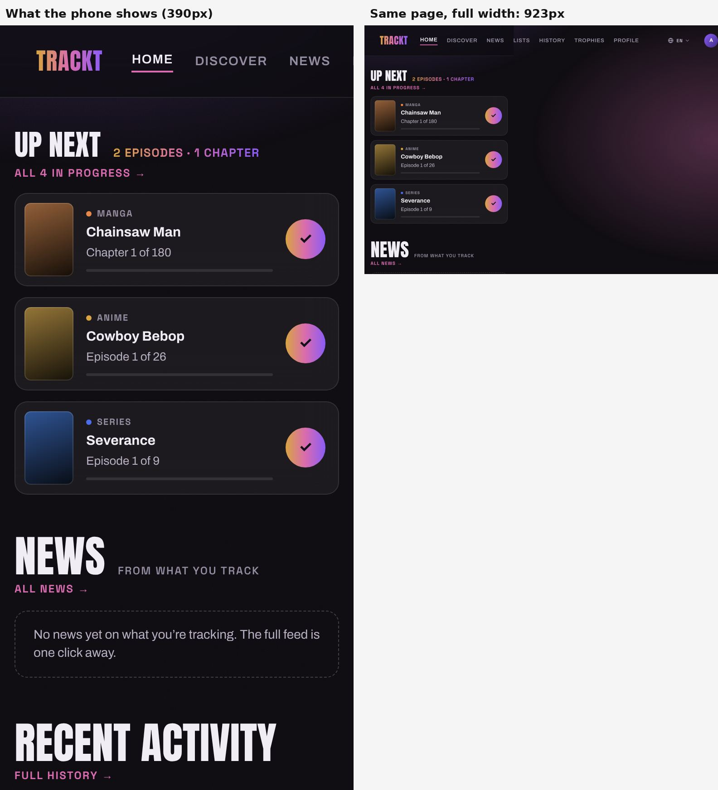

`AppNav` lays out in one row: the wordmark, 7 section links, the locale menu and the avatar. It uses fixed `px-10`, `gap-8` and `gap-6` and has no breakpoint variants. Its minimum width is 923px. At 390px only HOME, DISCOVER and NEWS are visible. LISTS, HISTORY, TROPHIES, PROFILE, the locale switch and the account avatar are all off-screen to the right. The nav's blurred background stops at the viewport edge, so the off-screen links float over the page when you pan to them.

- Measured: `nav.scrollWidth = 923`, `documentElement.scrollWidth = 923`, `clientWidth = 390`.
- Source: `apps/web/src/components/layout/AppNav.tsx:73` (the nav) and `:77` (the link row).
- `NavSearch` is already `hidden … lg:flex`, so search drops out on mobile but nothing replaces it.

**Fix direction:** below `md`, collapse the links into a bottom tab bar, which fits the app's existing HOME/DISCOVER/… hierarchy, or into a menu sheet. Keep the wordmark and avatar in the top bar, and reduce the padding to `px-4`.

## 2. Critical: full-screen dialogs open off-screen

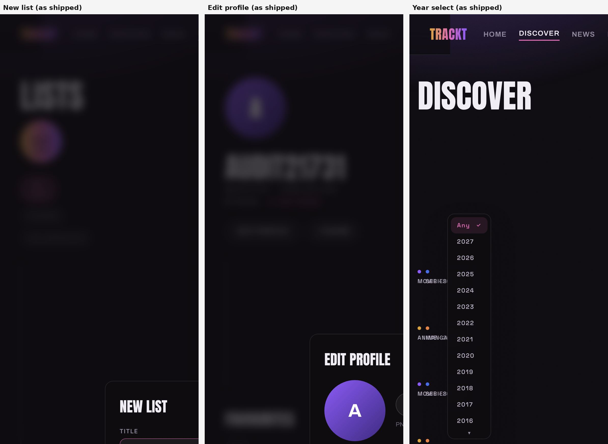

Once the document is 923px wide, `position: fixed; inset: 0` overlays and `left-1/2 -translate-x-1/2` modals are positioned in a 923px-wide box. On a 390px screen:

| Overlay                                 | Measured box (x) | Visible on a 390px screen |
| --------------------------------------- | ---------------- | ------------------------- |
| Onboarding (shown right after sign-up)  | 102 → 822        | left 288px of 720px       |
| New list (`Modal`)                      | 206 → 718        | left 184px of 512px       |
| Edit profile (`Modal`)                  | 206 → 718        | left 184px of 512px       |

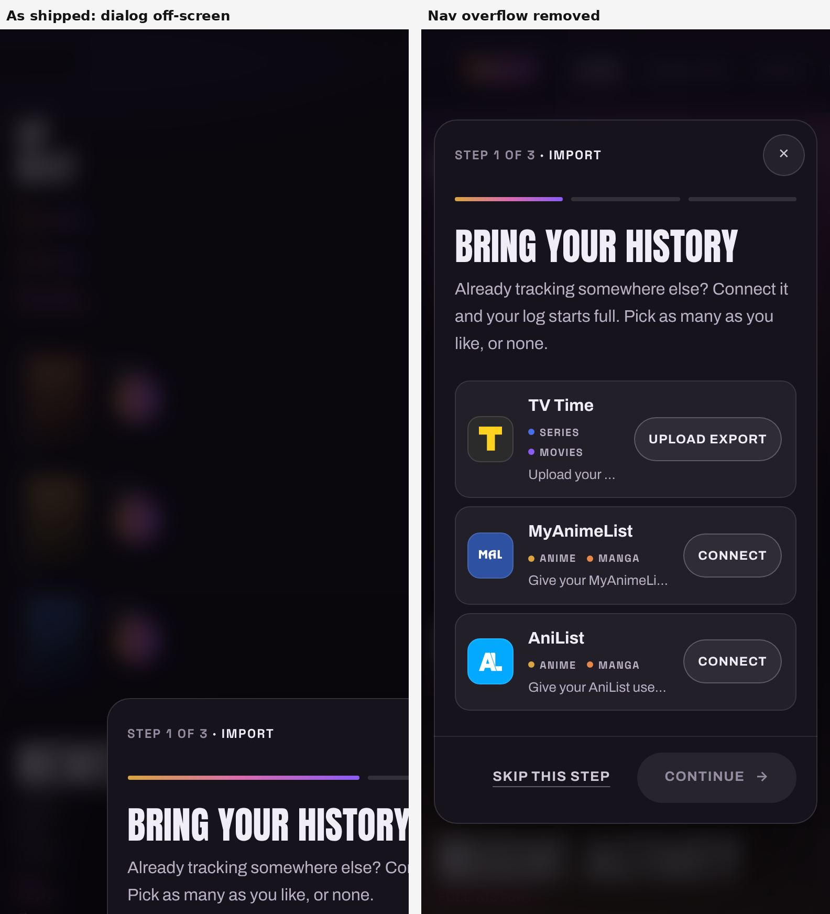

The onboarding dialog is the first thing a new user sees, and it renders as the right-hand third of a card in the bottom corner. With the nav overflow removed, it fits correctly (right panel). The Discover year `Select` shows a related symptom: when it opens, the scroll lock reflows the page behind it and the media grid labels overlap (`MOSERIES`, `ANIMANGA`, right panel of the first image).

- Source: `apps/web/src/components/onboarding/OnboardingDialog.tsx:166` and `apps/web/src/components/ui/Modal.tsx:45`. Both dialogs are correct in isolation. **Fixing #1 fixes this.**

## 3. Critical: account menu unreachable

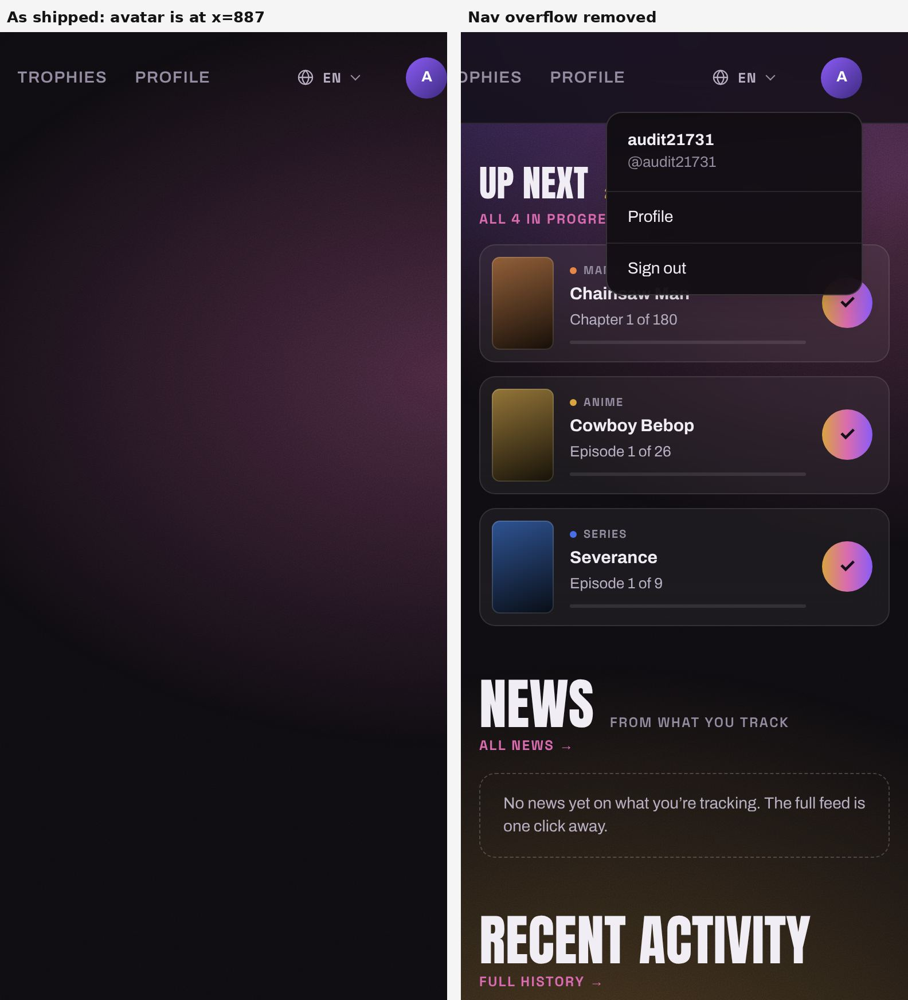

The avatar trigger sits at x=887px. Playwright couldn't tap it at 390px: the click timed out because the element was outside the viewport. A real user has to pan sideways to find **Sign out** and **Profile**. With the nav neutralised, the menu itself is fine (224px wide, aligned to the end, fully on-screen). **Fixing #1 fixes this.**

## 4. High: ranked list rows collapse

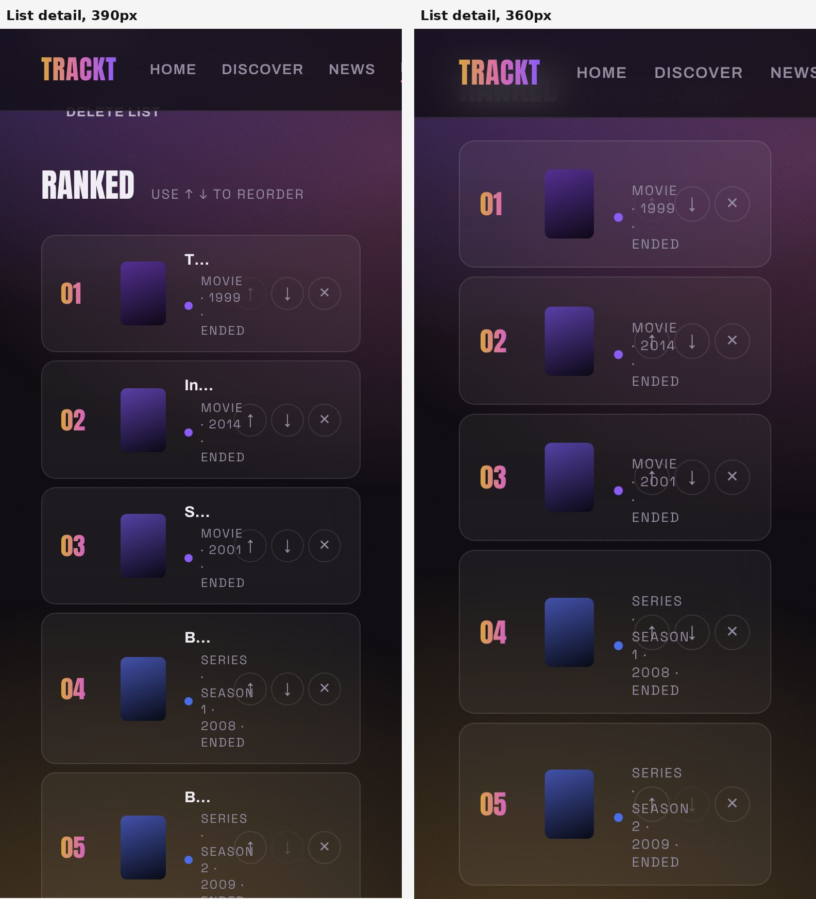

Each row is `rank (40px) + poster (44px) + text (flex-1) + three 32px buttons`, inside a card with 18px padding, inside a page with a 40px gutter. At 390px that leaves about **30px** for the text column (the title link measures 30×23px):

- titles truncate to `T…`, `In…`, `S…`, and **disappear entirely at 360px**;
- the `MOVIE · 1999 · ENDED` metadata wraps one token per line;
- the ↑ reorder button sits on top of the year text.

Source: `apps/web/src/routes/lists_.$id.tsx:255–290` (row) and `:354` (`px-10` main).
**Fix direction:** below `sm`, move the reorder and remove controls under the text, or behind a single "⋯"/drag handle. Shrink the rank column. Use the page gutter from #5.

## 5. High: inconsistent and oversized page gutters

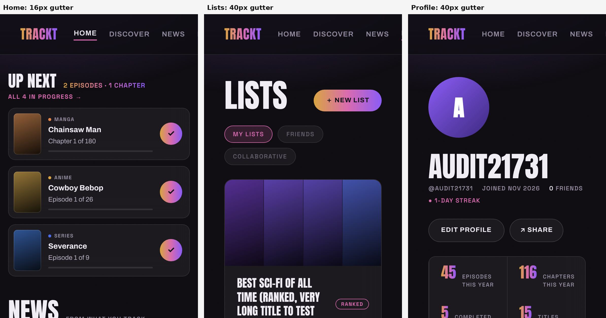

| Gutter at 390px | Routes                                                                     |
| --------------- | -------------------------------------------------------------------------- |
| 16px            | `/home`, `/search`, `/media/:slug`, `/trophies` (`px-4 sm:px-10`)          |
| 24px            | `/news`, `/news/:slug`, history (`px-6 sm:px-10`)                          |
| **40px**        | `/lists`, `/lists/:id`, `/users/:u` (own and others), media error states (`px-10`, no breakpoint) |

On the 40px routes, 80 of the 390px go to margins, which directly causes the squeeze in #4. Sources: `routes/lists.tsx:56`, `routes/lists_.$id.tsx:354`, `routes/users.$username.tsx:66,76`, `components/profile/OwnProfile.tsx:70,79`, `components/profile/NoSuchUser.tsx:8`, `routes/media.$slug.tsx:263,282,298`.
**Fix direction:** use one shared page container (for example `px-4 sm:px-10`) on every route.

## 6. High: kind filter is unlabelled on touch

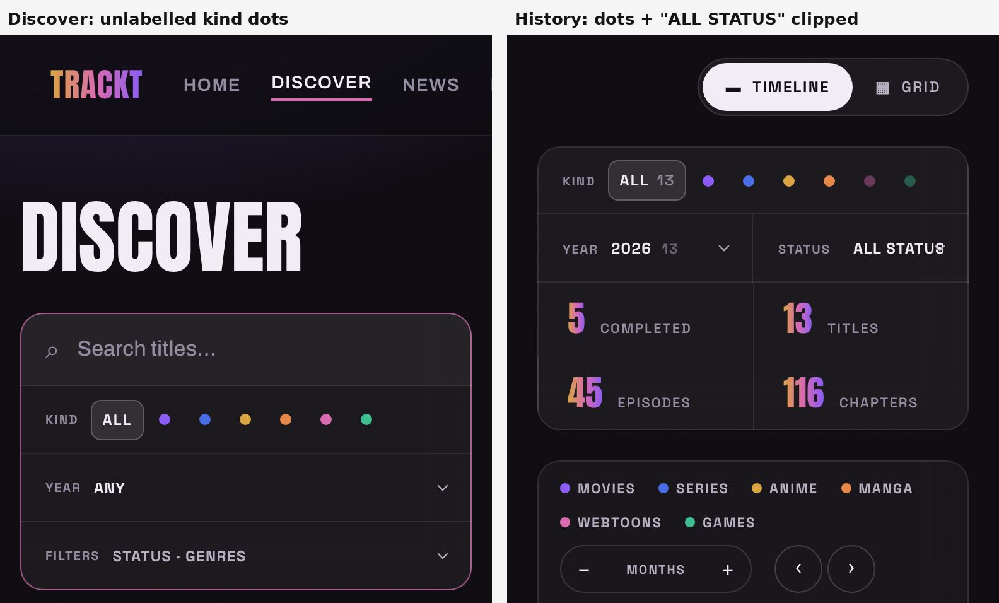

The KIND filter on Discover, History and News shows six coloured dots. The label is hidden with `max-width: 0; opacity: 0` and appears only on `:hover`, `:focus-visible`, or once the chip is selected (`apps/web/src/styles.css:506`). A phone has no hover, so the user has to tap a dot to find out what it filters. Each chip is also **30×32px**.
**Fix direction:** below `sm`, always show the label in a horizontally scrolling strip, or replace the strip with a select.

## 7. Medium: "Create & add" exits the Add to list dialog

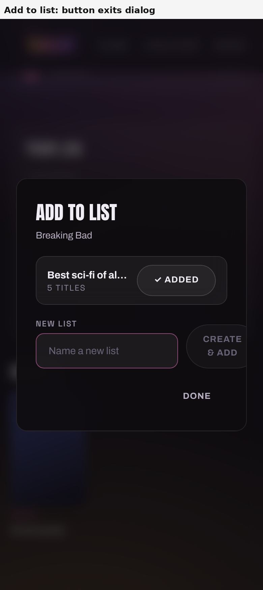

The new-list form is a single `flex items-end` row: the input (`flex-1`) followed by the button. The button doesn't shrink, so it ends at x=384 while the dialog ends at x=366. It is clipped by the dialog's rounded edge and wraps to two lines. Source: `apps/web/src/components/media/AddToListDialog.tsx:113`.
**Fix direction:** stack the input and button below `sm`.

## 8. Medium: inputs trigger iOS zoom-on-focus

Measured computed `font-size` is **15px** on login/register (email, password, username), New list (title, description) and Add to list (name). All of these use the shared `Input` (`apps/web/src/components/ui/Input.tsx:21`), as do Edit profile, Add friend and Import. iOS Safari zooms the page when a field under 16px gets focus, and the page stays zoomed after the keyboard closes. Combined with the 923px document, this leaves users zoomed into a sideways-scrolling page. Discover's search field is 17px and is not affected. _This was not reproduced in Chromium; the 16px threshold is documented WebKit behaviour._
**Fix direction:** `text-base` (16px) on inputs below `sm`.

## 9. Medium: sticky landing nav eats a fifth of the screen

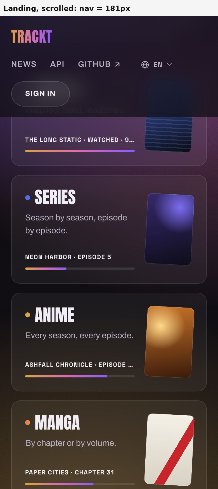

`MarketingNav` wraps into three rows (wordmark / links + locale / SIGN IN) and stays `sticky`. It is **181px tall, 21% of an 844px screen**, on every scroll position of the landing page. Source: `apps/web/src/components/layout/MarketingNav.tsx:29`.
**Fix direction:** keep it to one row on mobile (wordmark + SIGN IN, with the links in a menu), or make it non-sticky below `sm`.

## 10. Medium: small tap targets

Interactive elements under 32px, from the 390px run (sizes in CSS px). Most of these are text links, but several are primary navigation:

| Element                                       | Size           | Pages                     |
| --------------------------------------------- | -------------- | ------------------------- |
| App nav links (HOME…PROFILE)                  | 43–80 × **24** | all signed-in             |
| Kind filter chips                             | **30 × 32**    | Discover, History, News   |
| Timeline earlier/later arrows                 | **28 × 28**    | Profile                   |
| Timeline entries                              | n × **28**     | Profile                   |
| Dates "edit" pencil                           | **29 × 33**    | Media                     |
| List reorder / remove buttons                 | **32 × 32**    | List detail               |
| Landing nav links (NEWS / API / GITHUB)       | n × **20**     | `/`                       |
| "ALL NEWS →", "FULL HISTORY →" section links  | n × **16**     | Home, Profile             |
| "⚑ REPORT AN ISSUE", "CLEAR PROGRESS"         | n × 17–29      | Media                     |
| Onboarding step tabs                          | 221 × **20**   | Onboarding                |

The recommended minimum is 44×44 (Apple) or 48×48 (Material). Small text links can keep their visual size and get a larger hit area through padding.

## 11. Low: clipped filter values

- History → STATUS cell: "ALL STATUSES" measures `scrollWidth 96 > clientWidth 80` and renders as "ALL STATUS" with the chevron on top of it (second panel of the image in #6).
- News → SHOW cell: "EVERYTHING" truncates to "EVERYTH…".

Both are `.fcell` cells with `flex: 1 1 170px` sharing a row at 390px (`apps/web/src/styles.css:305`). Stack the cells one per row below `sm`.

## 12. Low: profile timeline is cramped

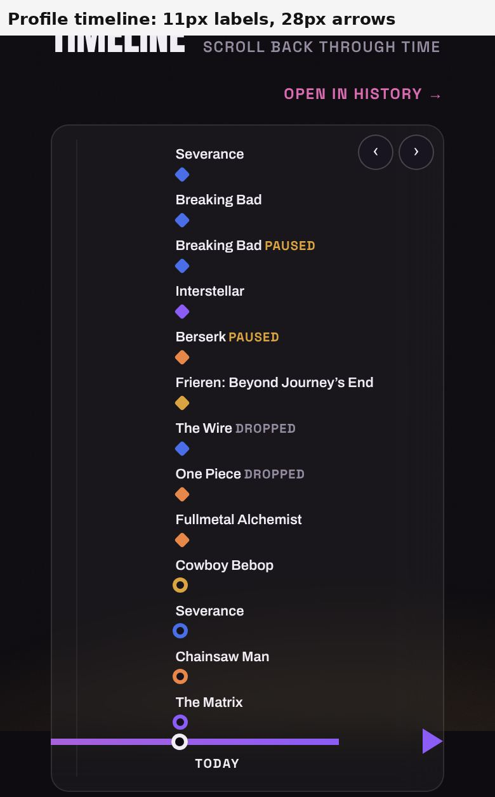

The desktop Gantt-style timeline is shrunk to fit rather than redesigned. Labels are about 11px, the earlier/later arrows are 28px, and the left third of the card is empty track. The History page's own legend reads "SCROLL SIDEWAYS OR USE < > TO MOVE THROUGH TIME", even though the mobile layout scrolls vertically. _The test account's entries all fall on one day, which exaggerates the stacking; the type and tap-target sizes don't depend on the data._

## 13. Low: trophy shelves

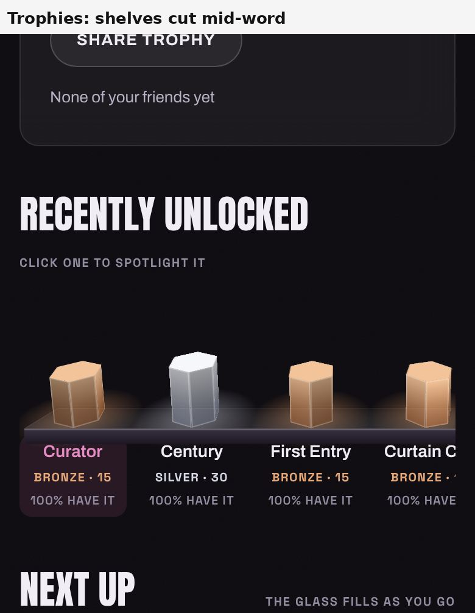

The shelves scroll horizontally, which works on touch, but the last visible item is cut mid-word ("Curtain C…", "BRONZE · '") instead of on an item boundary. The heading copy says "CLICK ONE TO SPOTLIGHT IT". A partially visible card is a reasonable scroll hint, so this is cosmetic. Snapping (`scroll-snap-type: x mandatory`) with a clear peek would read better.

---

## What already works

- **Landing page** content sections stack cleanly at 360 and 390.
- **Login / register** fit with no overflow and have full-width buttons.
- **Page bodies** of Home, Discover (2-column poster grid), media detail (single column, `lg:` two-column), and Trophies stack correctly once the nav is set aside.
- **Radix menus, popovers and selects** position correctly when the viewport isn't widened by the nav (Discover filters popover 358px wide, status select, account menu).
- **Onboarding dialog** has a proper mobile layout (`p-3 sm:p-8`, full-bleed card). It is only broken by #1.

## Suggested order of work

1. **Responsive `AppNav`** (#1). This alone fixes #2 and #3 and removes all sideways scroll.
2. **Shared page container gutter** (#5), then the **list detail row** (#4).
3. **Kind chips** (#6), **AddToList form** (#7), **16px inputs** (#8), **landing nav** (#9).
4. Tap-target pass (#10) and the low-severity items.

A good regression guard once #1 lands: a Playwright check that asserts `documentElement.scrollWidth <= clientWidth` on each signed-in route at 360px.

---

## Fixes

Re-measured after the fixes with the same method (Playwright, Chromium phone emulation, seeded dev stack). Every route listed above now has `scrollWidth == clientWidth` at both 390px and 360px. The desktop nav still fits on one row from 1024px up, in English and French.

| #   | Fix                                                                                                                                                                                                                                       |
| --- | ----------------------------------------------------------------------------------------------------------------------------------------------------------------------------------------------------------------------------------------- |
| 1   | Below `lg`, `AppNav` is a compact top bar (wordmark, locale, avatar) above a full-width tab strip that scrolls sideways and centres the current section. Links are 44px tall. `px-4 sm:px-10`, and tighter gaps at `lg` so the row fits at 1024px. |
| 2–3 | Fixed by #1: the onboarding dialog, New list, Edit profile and the account menu all open on-screen.                                                                                                                                       |
| 4   | Below `sm`, the score and the ↑ ↓ ✕ controls move under the title, and the rank column narrows. Controls are 44px on phones. Metadata truncates on one line.                                                                              |
| 5   | Every `<main>` uses `px-4 sm:px-10`.                                                                                                                                                                                                      |
| 6   | Below `sm`, kind chips always show their name and count, sit in a strip that scrolls sideways, and are 44px tall.                                                                                                                         |
| 7   | The Add to list form stacks below `sm`.                                                                                                                                                                                                   |
| 8   | `Input`, the list, profile and feedback textareas, profile social links, onboarding search, genre search and the date field are 16px below `sm`. The label-font date cells in filter bars are unchanged.                                  |
| 9   | `MarketingNav` is one 70px row below `sm`: wordmark, a menu holding NEWS / API / GITHUB, locale, SIGN IN.                                                                                                                                 |
| 10  | New `tap-area` utility gives small text controls a hit area of at least 44×44px without changing how they look. It is used on section links (ALL NEWS →, FULL HISTORY →, …), REPORT AN ISSUE, CLEAR PROGRESS, the dates EDIT button and the onboarding step tabs. |
| 11  | Filter cells stack one per row below `sm`.                                                                                                                                                                                                |
| 12  | Profile timeline labels are 12px and its arrows are 44px on phones. The empty track before the first entry depends on the data, so it is unchanged.                                                                                       |
| 13  | Trophy shelves snap to an item on the left edge. The hint says "PICK ONE" instead of "CLICK ONE". The right edge still cuts an item at whatever width the screen gives.                                                                   |

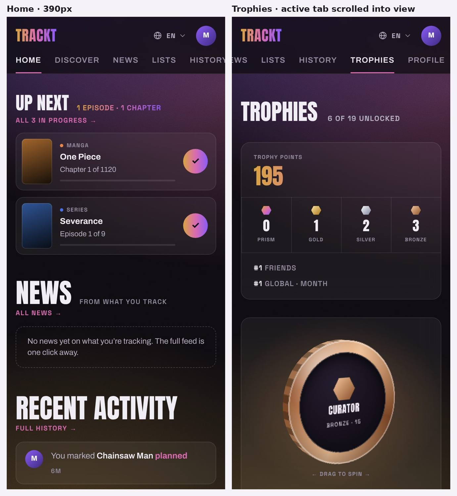
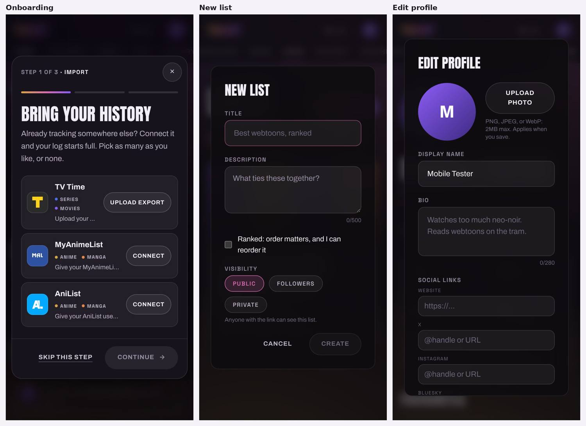
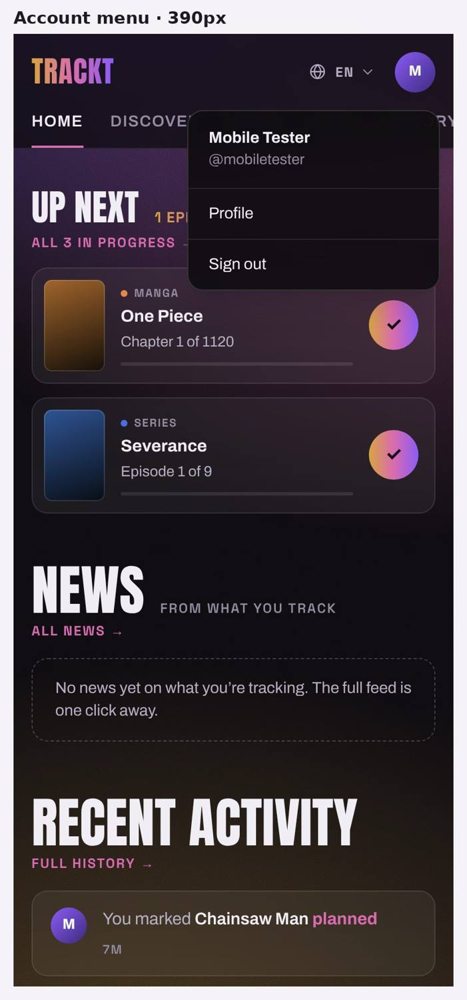
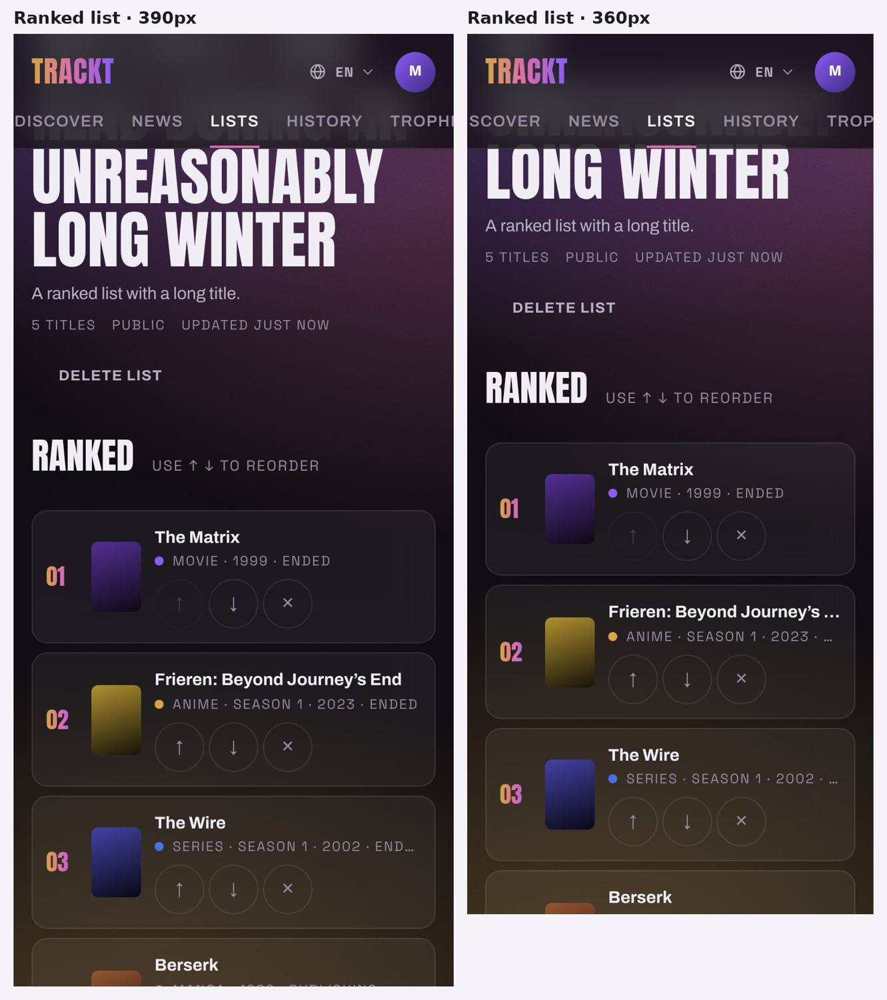
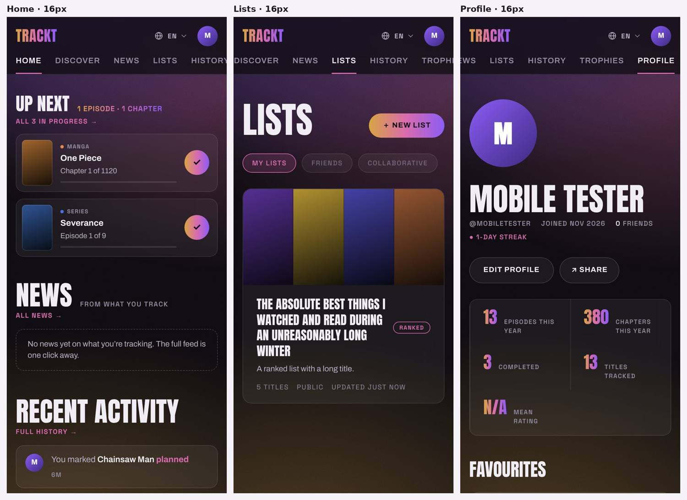
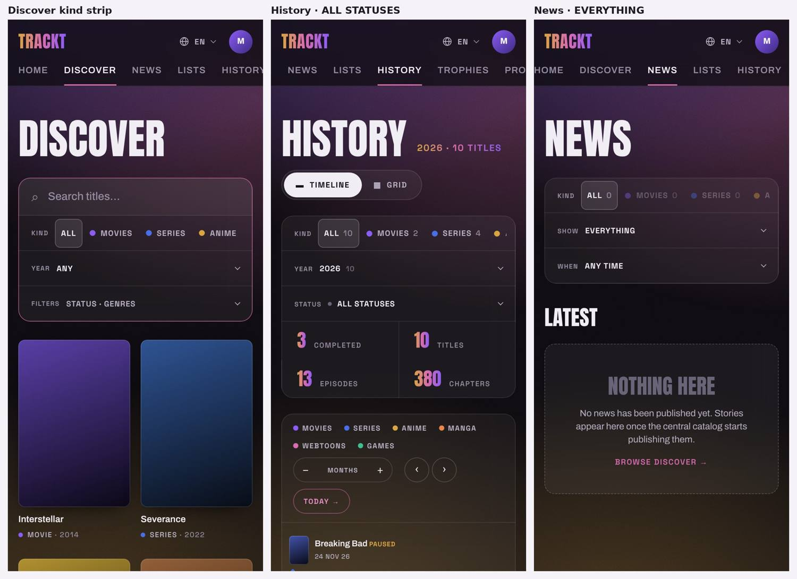
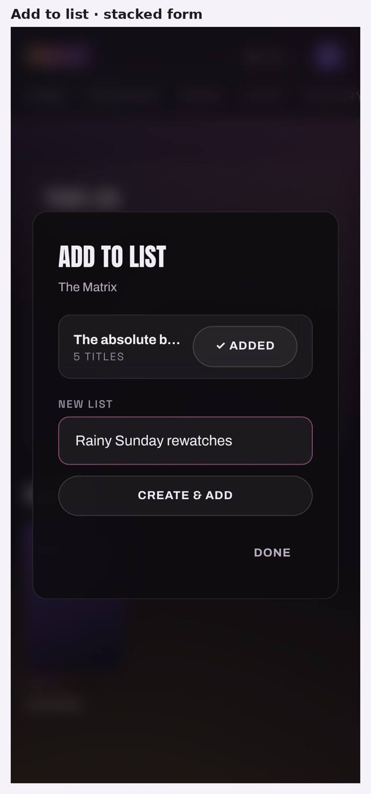
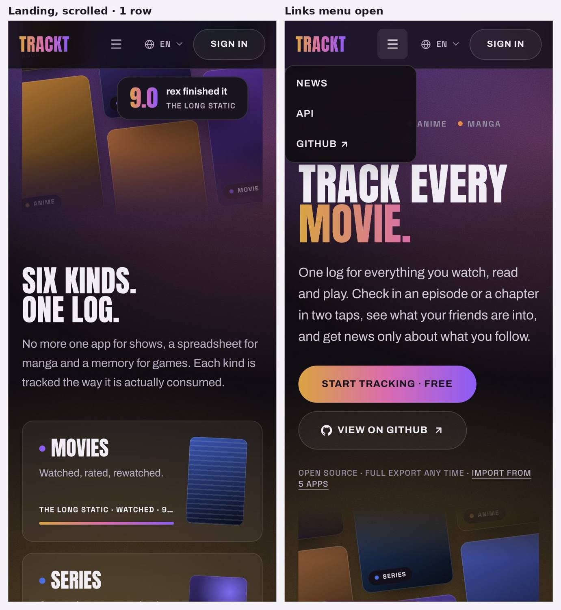
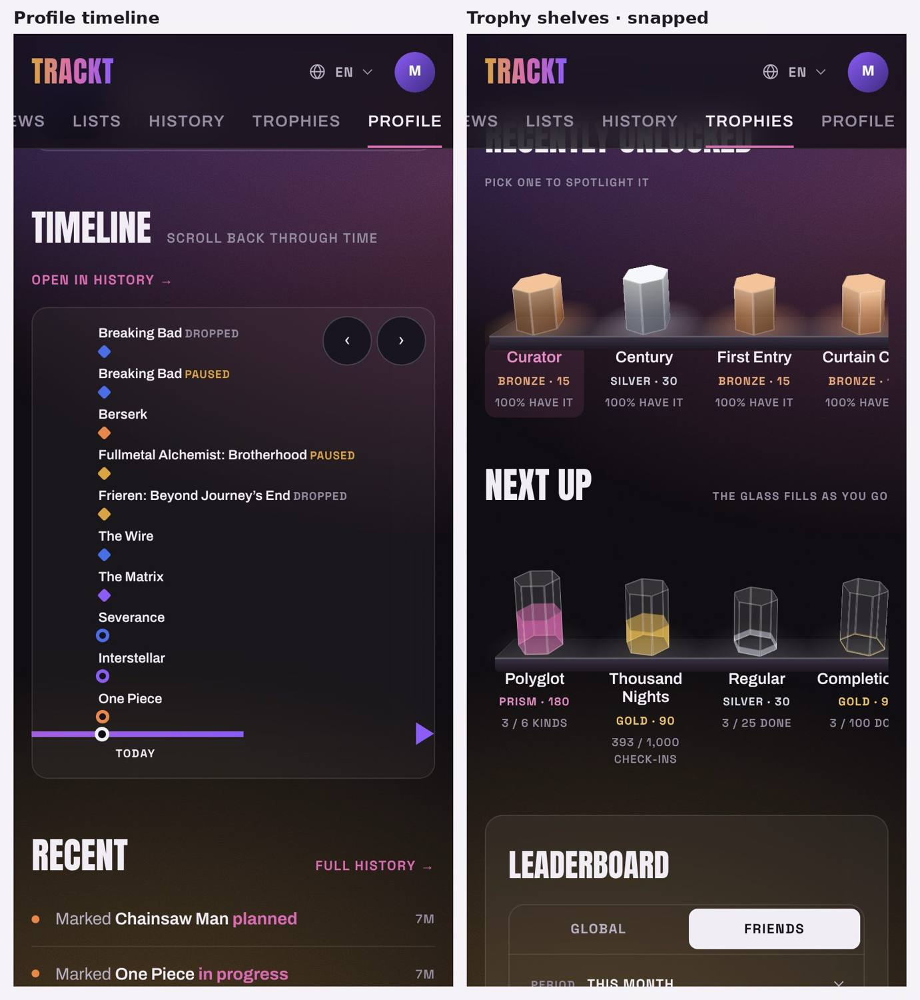
